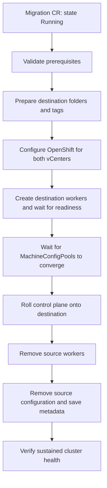

# Project code flow

This Go operator moves an existing OpenShift cluster onto machines in a destination vCenter. The core mechanism is replacement: create destination workers, roll the control plane onto destination machines, then retire the source.

## Startup and user input

[cmd/main.go](../../cmd/main.go) creates the controller-runtime manager and Kubernetes/OpenShift clients, then registers the reconciler.

The [migration API](../../api/v1alpha1/vmwarecloudfoundationmigration_types.go) supplies destination credentials, failure domains—including topology and VM templates—and a `Pending`, `Planning`, `Running`, or `Paused` state. Only the `openshift-vcf-migration/cluster` resource is processed. `Planning` runs non-disruptive preflight and storage inventory, writes namespace-scoped `StorageWorkloadMigration` records, and reports `PlanComplete` or `PlanBlocked`. `Running` continues through the migration workflow after those checks pass. See the [Planning phase](../csi-migration-plan/01-planning-phase.md).

## Reconciliation engine

[Reconcile()](../../internal/controller/vmwarecloudfoundationmigration_controller.go) walks a fixed list of status conditions:

1. `InfrastructurePrepared`
2. `StoragePlanned`
3. `DestinationInitialized`
4. `MultiSiteConfigured`
5. `WorkloadMigrated`
6. `SourceCleaned`
7. `Ready`

It executes the first incomplete stage, persists status, and returns. Conditions act as persistent checkpoints. Handlers inspect existing resources and readiness, while requeues let other controllers finish their work. Errors are recorded in conditions and Warning events, then retried with backoff.

## Preflight and destination preparation

[preflight.go](../../internal/controller/preflight.go) checks the `VSphereMultiVCenterDay2` feature gate, cluster health, credentials, topology, privileges, and interfering autoscalers or health checks.

[Network preflight](../../internal/controller/preflight_netcheck.go) clones temporary destination probe VMs and compares their guest networks with source node networks.

`ensureDestinationInitialized()` creates destination VM folders and attaches region, zone, and cluster ownership tags. The underlying vSphere operations live in [internal/vsphere](../../internal/vsphere).

## Configure both sites

`ensureMultiSiteConfigured()` adds destination credentials to `vsphere-creds`, adds destination topology to `Infrastructure/cluster`, and updates `cloud-provider-config`. It restarts MCO and vSphere components and waits for readiness.

Keeping both vCenters configured allows source machines to remain operational while destination machines are provisioned.

## Replace the machines

`ensureWorkloadMigrated()` coordinates the following sequence:

1. Copy a source MachineSet into destination MachineSets, rewriting their vSphere placement and VM template. OpenShift's Machine API controllers provision the actual VMs.
2. Wait for destination Machines and Nodes to become ready.
3. Wait for MachineConfigPools to converge before updating the ControlPlaneMachineSet. The earlier configuration changes can trigger node reboots; this gate avoids overlapping those reboots with control-plane replacement.
4. Update the ControlPlaneMachineSet with destination failure domains and set it to `Active`. The CPMS operator performs the control-plane rolling replacement; the migration code requires the `RollingUpdate` strategy or its API default.
5. Wait for the CPMS generation to be observed and the rollout to complete.
6. Scale source worker MachineSets to zero, wait for source Machine and Node deletion, then delete the empty source MachineSets.

[internal/openshift/machines.go](../../internal/openshift/machines.go) implements the MachineSet and CPMS resource operations. The migration reconciler controls their ordering and reports worker and control-plane progress in the migration status.

## Cleanup and completion

`ensureSourceCleaned()` removes source vCenter configuration and credentials, restarts vSphere components, and saves installer-compatible metadata in a Secret.

[internal/metadata](../../internal/metadata) generates the metadata used for later cluster teardown. The Secret contains `metadata.json`, is named `{migration-name}-metadata`, and remains available after the migration resource is deleted.

`ensureReady()` requires stable ClusterOperators, converged MachineConfigPools, and only destination vCenters remaining in Infrastructure. These checks must pass across six observations at least 30 seconds apart. A failing check, a gap longer than 90 seconds, or a controller restart resets the stability window. Once the checks pass, the controller sets `Ready=True` and records `completionTime`.

## Package responsibilities

- [internal/controller](../../internal/controller): migration sequencing, preflight checks, conditions, and progress reporting.
- [internal/openshift](../../internal/openshift): cluster resource operations, including Infrastructure, credentials, cloud configuration, Machines, and health checks.
- [internal/vsphere](../../internal/vsphere): govmomi sessions, inventory operations, folders, tags, and probe VMs.
- [internal/metadata](../../internal/metadata): installer-compatible teardown metadata.
- [internal/metrics](../../internal/metrics): Prometheus metrics derived from migration status.
- [config](../../config): CRDs, RBAC, deployment manifests, and sample resources.

## Storage scope

With `spec.migrateStorage: false` (the default), preflight rejects PersistentVolumes using `csi.vsphere.vmware.com` and requires the vSphere `ClusterCSIDriver` management state to be `Removed`. With `spec.migrateStorage: true`, it requires `Managed` and inventories vSphere-backed volumes into storage plans. Only planning is implemented; data transfer and cutover remain later phases. A successful plan does not mean volume data has been migrated.
